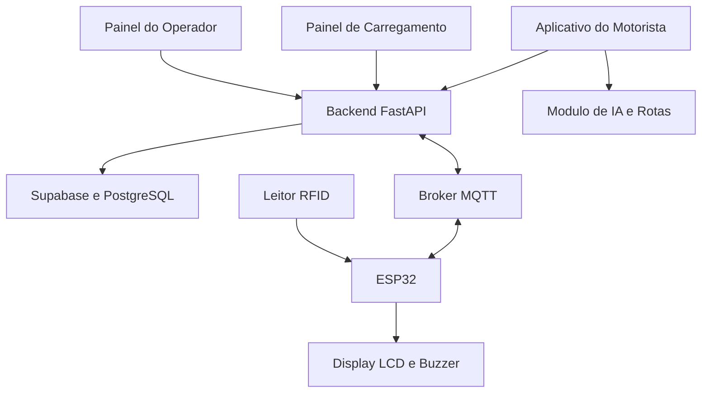

# ⚡ ChargeGrid
### Ecossistema Inteligente de Mobilidade Elétrica

**Conectando veículos elétricos, inteligência artificial, infraestrutura de recarga e gestão energética em uma única plataforma.**


---

## Sobre o projeto

O **ChargeGrid** é um ecossistema de software e hardware desenvolvido para tornar o carregamento de veículos elétricos mais inteligente, acessível e eficiente.

Criado no contexto do **Challenge FIAP × GoodWe**, o projeto propõe uma solução integrada para três participantes fundamentais da mobilidade elétrica:

- **Motoristas**, que precisam localizar pontos de recarga, acompanhar seus veículos e planejar viagens.
- **Operadores**, que precisam monitorar eletropostos, acompanhar sessões e compreender o consumo energético.
- **Infraestrutura física**, que precisa se comunicar com aplicações digitais de maneira confiável.

A plataforma combina desenvolvimento web, APIs, banco de dados, inteligência artificial, comunicação MQTT e um protótipo físico baseado em ESP32.

> Nosso objetivo não é apenas digitalizar um eletroposto, mas integrar toda a experiência de mobilidade elétrica em um único sistema.

---

## O problema que buscamos resolver

A expansão dos veículos elétricos apresenta desafios que vão além da instalação de novos carregadores.

**Ansiedade de autonomia:** motoristas precisam saber se a carga disponível é suficiente para concluir uma viagem e onde poderão recarregar.

**Informações fragmentadas:** dados de veículos, carregadores, pagamentos e histórico de consumo frequentemente estão distribuídos entre sistemas diferentes.

**Demanda energética:** operadores precisam entender como múltiplas sessões de carregamento impactam a utilização da infraestrutura.

**Integração física e digital:** os equipamentos precisam comunicar eventos e estados para interfaces de usuário e serviços de backend.

O ChargeGrid foi desenvolvido para explorar uma abordagem integrada a esses problemas.

---

## Funcionalidades

### 1. Inteligência Artificial de Rotas

O ChargeGrid possui um módulo de planejamento de viagens voltado a veículos elétricos.

A solução considera informações como origem, destino, modelo do veículo, capacidade da bateria, percentual de carga e estimativas de consumo.

Com esses dados, o sistema pode estimar a autonomia, analisar a necessidade de recargas e apresentar informações de planejamento de viagem.

O projeto também explora integração com dados públicos de infraestrutura de carregamento.

**Diferencial técnico:** os cálculos energéticos são tratados como regras do sistema. A IA atua como uma camada de interpretação e assistência, reduzindo a dependência de respostas geradas livremente por modelos de linguagem.

As estimativas consideram hipóteses de consumo e não garantem a autonomia real do veículo. Fatores como relevo, temperatura, trânsito e estilo de condução podem alterar os resultados.

### 2. Aplicativo do Motorista

Interface desenvolvida para centralizar a experiência de quem utiliza um veículo elétrico.

Principais módulos:

- Autenticação e gerenciamento de conta
- Cadastro e gerenciamento de veículos
- Visualização de eletropostos
- Histórico de carregamento
- Carteira digital e registros financeiros
- Planejamento inteligente de viagens
- Assistente de suporte

O aplicativo utiliza **React, TypeScript e TanStack Start**, com integração ao Supabase.

### 3. Painel de Carregamento

Interface voltada à experiência de recarga em um eletroposto.

O painel contempla o fluxo de identificação do motorista, seleção de preferências, acompanhamento da sessão e informações relacionadas ao carregamento.

Foi construído em **React, TypeScript e Vite**, priorizando uma interface visual simples e de fácil utilização.

### 4. Integração IoT com ESP32 e RFID

Um dos principais diferenciais do projeto é a integração entre o ambiente digital e um protótipo físico de carregamento.

O hardware utiliza:

- Microcontrolador ESP32
- Leitor RFID MFRC522
- Display LCD
- Buzzer para feedback sonoro
- Comunicação Wi-Fi
- Protocolo MQTT

O ESP32 transmite eventos de hardware por MQTT, permitindo que o backend interprete interações físicas e as conecte aos fluxos da aplicação.

Essa arquitetura demonstra a integração entre **sistemas embarcados, eventos assíncronos, serviços backend e interfaces web**.

O protótipo utiliza RFID para identificação. Operações sensíveis exigem controles de autorização adicionais para uma implementação em produção.

### 5. Painel do Operador

Aplicação administrativa voltada ao acompanhamento operacional dos eletropostos.

| Módulo | Responsabilidade |
|---|---|
| Dashboard | Visão geral dos indicadores operacionais |
| Eletropostos | Gerenciamento e acompanhamento das estações |
| Sessões | Consulta das atividades de carregamento |
| Clientes | Informações sobre os usuários |
| Financeiro | Acompanhamento dos registros financeiros |
| Demanda | Análise da utilização energética |
| Inteligência | Indicadores e análises assistidas por IA |

O painel utiliza React e TypeScript e se comunica com os serviços do backend.

### 6. Gestão da Demanda Energética

Além da experiência do motorista, o ChargeGrid aborda a operação energética dos pontos de recarga.

O módulo de demanda explora o acompanhamento de informações como potência, consumo, utilização e sessões de carregamento.

Esses dados podem apoiar análises de capacidade, identificação de padrões de uso e planejamento da infraestrutura.

A proposta é contribuir para uma operação de carregamento mais eficiente e orientada por dados.

---

## Arquitetura do Sistema

O ChargeGrid adota uma arquitetura modular, separando as interfaces, as regras de negócio, a persistência de dados e a comunicação com o hardware.



### Decisões de arquitetura

**Separação de responsabilidades:** cada aplicação apresenta funcionalidades específicas, enquanto o backend centraliza regras de negócio e integrações.

**Comunicação orientada a eventos:** o MQTT permite transmitir interações do hardware sem depender exclusivamente de requisições HTTP.

**Persistência relacional:** PostgreSQL e Supabase são utilizados para dados estruturados do sistema.

**IA integrada a regras determinísticas:** cálculos críticos, especialmente os relacionados à energia e autonomia, devem permanecer verificáveis e independentes das respostas do modelo.

**Modularidade:** os diferentes serviços podem evoluir sem exigir a reconstrução completa da plataforma.

---

## Tecnologias Utilizadas

| Categoria | Tecnologias |
|---|---|
| Frontend | React, TypeScript, Vite |
| Aplicação full-stack | TanStack Start, TanStack Router |
| Interface | Tailwind CSS, Lucide Icons |
| Backend | Python, FastAPI |
| Banco de dados | PostgreSQL, Supabase |
| Autenticação | Supabase Auth |
| Comunicação | APIs REST, MQTT |
| Hardware | ESP32, RFID MFRC522, LCD |
| Mapas | Leaflet, React Leaflet |
| Dados de carregadores | Open Charge Map |
| Versionamento | Git, GitHub |

---

## Estrutura do Repositório

```text
Chargegrid/
|
|-- app_chargergrid/
|   |-- src/
|   |   |-- components/
|   |   |-- lib/
|   |   |-- routes/
|   |   |-- integrations/
|   |-- package.json
|
|-- painel-carregamento/
|   |-- src/
|   |-- package.json
|
|-- painel-operador/
|   |-- src/
|   |-- package.json
|
|-- backend_python/
|   |-- ai/
|   |-- main.py
|   |-- admin.py
|   |-- mqtt_bridge.py
|   |-- demand_control.py
|   |-- wallet.py
|
|-- docs/
|   |-- architecture.md
|   |-- data-flow.md
|   |-- database.md
|   |-- assistente.md
|
|-- README.md
```

A organização em múltiplas aplicações permite desenvolver e testar os principais módulos de forma relativamente independente.

---

## Como Executar Localmente

### Pré-requisitos

- Node.js e npm
- Python
- Git
- Projeto Supabase configurado
- Broker MQTT para as funcionalidades relacionadas ao hardware
- Variáveis de ambiente necessárias às integrações utilizadas

### 1. Clonar o repositório

```bash
git clone https://github.com/Camper-Lingo/Chargegrid.git
cd Chargegrid
```

### 2. Aplicativo do motorista

```bash
cd app_chargergrid
npm ci
npm run dev
```

Configure as variáveis de ambiente exigidas pela aplicação utilizando o arquivo `.env.example` como referência.

### 3. Painel de carregamento

Em outro terminal:

```bash
cd painel-carregamento
npm ci
npm run dev
```

### 4. Painel do operador

Em outro terminal:

```bash
cd painel-operador
npm ci
npm run dev
```

### 5. Backend Python

Entre na pasta `backend_python` e crie um ambiente virtual:

```bash
python -m venv .venv
```

No Windows PowerShell:

```powershell
.\.venv\Scripts\Activate.ps1
```

Instale as dependências Python de acordo com a configuração do backend e execute:

```bash
python -m uvicorn main:app --reload --port 8000
```

A documentação interativa da API estará disponível em:

`http://localhost:8000/docs`

**Importante:** funcionalidades integradas dependem da configuração dos serviços externos, do banco de dados e, quando aplicável, do hardware. A compilação das interfaces não garante que todas as integrações estejam operacionais em um novo ambiente.

---

## Principais Desafios Técnicos

### Integração entre software e hardware

Construir a comunicação entre o ESP32 e os serviços Python exigiu organizar eventos físicos, mensagens MQTT, identificação de dispositivos e atualização do estado das aplicações.

### Planejamento de viagens com restrições energéticas

O planejamento de rotas para veículos elétricos envolve restrições diferentes das encontradas em sistemas de navegação tradicionais.

É necessário considerar energia disponível, consumo estimado, distância, margem de segurança e oportunidades de recarga.

### Consistência entre aplicações

O sistema possui múltiplas interfaces que dependem dos mesmos conceitos de usuário, veículo, sessão e estação de carregamento.

Isso exige contratos de API, persistência consistente e uma separação clara das responsabilidades.

### Segurança e autenticação

O projeto incorpora conceitos de autenticação, identificação por RFID e controle de acesso a dados e funcionalidades.

A evolução para um ambiente de produção exige validações adicionais de segurança, autorização, gestão de credenciais e testes.

---

## Próximas Evoluções

- [ ] Expandir a cobertura e a confiabilidade dos dados de eletropostos públicos
- [ ] Melhorar os modelos de consumo e autonomia dos veículos
- [ ] Considerar desvios, conectores compatíveis e disponibilidade de recarga nas rotas
- [ ] Incorporar recomendações mais completas de serviços próximos às paradas
- [ ] Evoluir a análise e previsão de demanda energética
- [ ] Fortalecer os mecanismos de autenticação e autorização
- [ ] Ampliar testes automatizados e de integração
- [ ] Melhorar observabilidade e tratamento de falhas
- [ ] Concluir integrações financeiras para ambientes reais
- [ ] Expandir os testes físicos e a interoperabilidade do hardware

---

## Documentação Técnica

Para informações mais detalhadas sobre o funcionamento e a organização do sistema:

- [Arquitetura](docs/architecture.md)
- [Fluxo de Dados](docs/data-flow.md)
- [Banco de Dados](docs/database.md)
- [Assistente de IA](docs/assistente.md)

---

## Contexto Acadêmico

O ChargeGrid foi desenvolvido por estudantes de **Ciência da Computação da FIAP**, no contexto de um desafio de inovação tecnológica relacionado à mobilidade elétrica e à GoodWe.

O projeto reúne conhecimentos de desenvolvimento de software, banco de dados, algoritmos, inteligência artificial, sistemas distribuídos e Internet das Coisas.

---

## Escopo do Protótipo

O ChargeGrid é um projeto acadêmico e uma demonstração de engenharia, não uma plataforma comercial certificada.

Algumas funcionalidades dependem de infraestrutura externa, dados de terceiros, simulações ou equipamentos de prototipagem.

A utilização comercial exigiria validação de segurança, atualização de dependências, testes operacionais e integração com equipamentos de carregamento certificados.

---

## Nossa Visão

> **A mobilidade elétrica não depende apenas de baterias e carregadores. Depende de sistemas inteligentes capazes de conectar pessoas, infraestrutura e energia.**

O ChargeGrid demonstra como diferentes áreas da computação podem trabalhar juntas para construir soluções voltadas à mobilidade do futuro.

**ChargeGrid — Inteligência que conecta. Energia que movimenta.** ⚡
